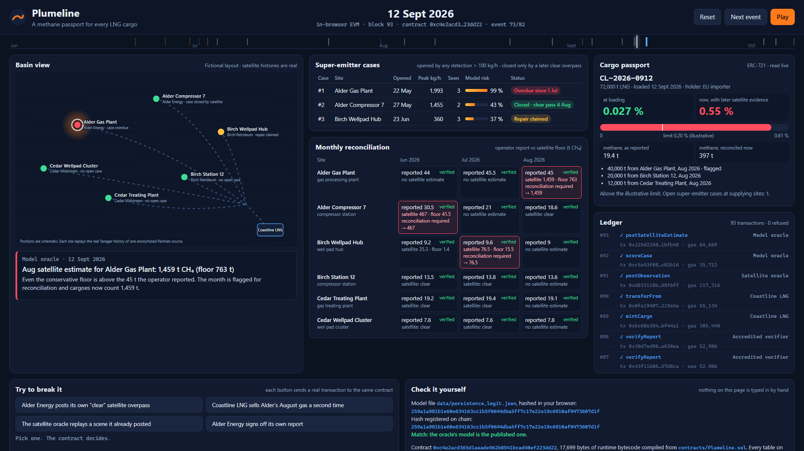
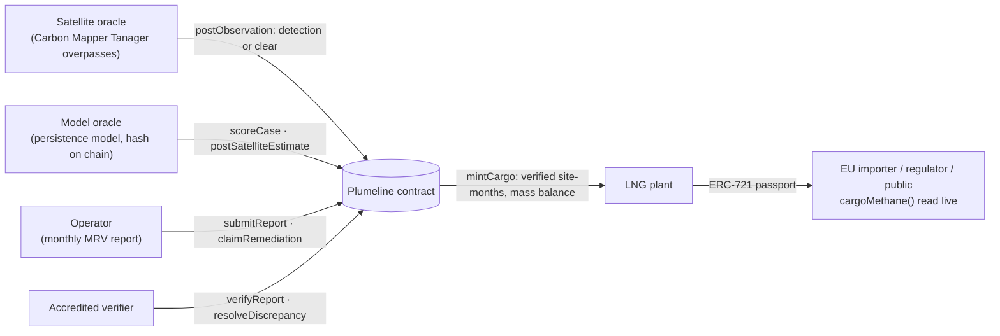

<!-- Plumeline 저장소 소개: 문제·구조·실데이터·모델·계약 규칙·실행 방법·한계 -->
# Plumeline

**Plumeline puts a methane passport on every LNG cargo.** Satellite methane observations go onto a shared ledger. Every super-emitter becomes a case that only the satellite can close. The gas from each cargo carries a methane intensity that the importer reads live.

**Track:** Sustainable Supply Chains (digital product passports). The project also falls under Carbon Markets & Emissions Transparency, because it tracks emissions in near real time.
**Built for:** IEEE ClimateChain Global Hackathon 2026.



## The problem

- **Methane's share of warming.** Methane is responsible for around 30 % of the rise in global temperatures since the Industrial Revolution. Energy-sector methane emissions are about 70 % higher than the figures governments report (IEA, *Global Methane Tracker*, 23 February 2022).
- **EU rules coming for imports.** Regulation (EU) 2024/1787 lets oil, gas and coal onto the EU market only if their methane is monitored, reported and verified to EU-equivalent standards (Art. 28). Importers must report the methane intensity of what they import (Art. 29(1)) and later stay below maximum values that are still to be set (Art. 29(2)). The Commission runs a satellite-based global monitoring tool and a rapid reaction mechanism for super-emitting events (Art. 31). A super-emitting event is a source emitting above 100 kg of methane per hour (Art. 2(62)).
- **A proposed delay.** On 14 October 2026 the Commission proposed postponing the import obligations by a year (proposal, not yet adopted). Among the reasons it gives: verifiers still need accreditation, and authorities still need to assess "compliance solution providers".

Satellites already see the biggest leaks. **The data is not the gap.** Today nothing connects a plume seen over a Texas compressor station to the cargo of LNG that unloads in Rotterdam. That link would carry two things to the buyer: whether the producer answered, and the methane that the operator's report left out.

## What Plumeline does



1. **Every overpass is on the ledger, including the clear ones.** The satellite oracle posts each overpass of each site, in time order, once per scene.
2. **Super-emitters become cases.** A detection above 100 kg/h opens a case, and the operator has 10 days to answer. A repair claim does not close it. Only a later clear overpass closes it. If the satellite still sees the plume after the claimed repair, the case goes back to open.
3. **Monthly reconciliation.** The operator's report is checked against the satellite each month. The model oracle posts a satellite-based estimate and a conservative floor for the month. If even the floor is above the report, the month is flagged: this is the "reconciliation process" of Art. 2(63). Cargoes then count the satellite estimate until an accredited verifier accepts an explanation.
4. **Cargo passports with a mass balance.** The LNG plant mints an ERC-721 passport from verified site-months. Each tonne can be allocated once, so the same low-methane gas cannot be sold into two cargoes.
5. **The passport is live.** Carbon Mapper publishes scenes about 30 days after capture. `cargoMethane()` recomputes the intensity from the current state, so evidence that arrives after loading still reaches the importer. The value at loading is kept beside it.

### The demo story (June – October 2026)

| | Site (fictional) | Real satellite history behind it | What happens |
|---|---|---|---|
| 1 | Alder Gas Plant | Detected in **12 of 12** Tanager overpasses, Oct 2024 – Aug 2026, mean 1,372 kg/h | Case opens 21 Jun and goes overdue with no answer. The August plume (1,993 ± 521 kg/h) is published on 12 Sep, the day cargo CL-2026-0912 loads. The August floor (763 t) is far above the 45 t reported, and the cargo's intensity goes from **0.027 %** at loading to **0.55 %**, above the illustrative 0.20 % limit. |
| 2 | Alder Compressor 7 | Detections 27 May and 3 Jun, clear 4 Aug | Repair claimed 2 Jul. The satellite closes the case on 3 Sep. June is flagged in reconciliation. |
| 3 | Birch Wellpad Hub | New plume 23 Jun, again 23 and 30 Jul, clear 5 Sep | Repair claimed 1 Aug. The late-published July plumes predate the repair, so they do not reopen the case. The satellite closes it on 5 Oct. July is flagged. |
| 4–6 | Birch Station 12, Cedar Treating Plant, Cedar Wellpad Cluster | Older detections only, clear overpasses in the window | No case. The reports stand. |

A second cargo that tries to sell 111,000 t of Alder's August gas (110,000 t are left) is refused with `OverAllocated`.

## Real and fictional

- **Real.** The real parts are these:
  - Every overpass time, detection, emission rate and uncertainty in the demo.
  - The 30-day publication delay.
  - The 909-source training set and the model.

  All satellite data comes from the **Carbon Mapper** public catalog (Tanager, Permian Basin). The six demo sources are anonymized, and their plume images are Carbon Mapper's.
- **Fictional.** These parts are made up: operators, site names, map positions, gas volumes, methane reports, the LNG plant, the cargo and the importer. No real company is shown or implied.

## Where the AI is

The **persistence model** is a logistic regression trained on 3,692 Tanager overpasses of 909 Permian sources. It gives the probability that a flagged site is still emitting at the next overpass. On a time split (test from 1 March 2026):

| | Result |
|---|---|
| AUC | 0.755 (95 % CI 0.697–0.808) |
| Log loss | 0.259, against 0.415 for counting past detections |
| Calibration | within about 3 points in every quintile |
| Triage | ranking by risk × rate puts 57.6 % of next-overpass methane in the top fifth of the queue, against 46.2 % by rate alone |

The model ranks sources about as well as counting past detections; its probabilities are what improve. Full numbers and limits are in [docs/MODEL_CARD.md](docs/MODEL_CARD.md).

The AI ranks and estimates. It never decides. The contract opens and closes cases by rule. The model's SHA-256 is registered on chain, and the demo page re-hashes the published model file to show it matches.

## The contract

`contracts/Plumeline.sol`: Solidity 0.8.28, OpenZeppelin 5 `ERC721` + `AccessControl`, 17.7 kB runtime.

| Rule | Error when broken |
|---|---|
| Only the site operator reports, once per site-month | `NotSiteOperator`, `ReportExists` |
| Only an accredited verifier verifies, never the operator | `AccessControlUnauthorizedAccount`, `SelfVerification` |
| Only the satellite oracle posts overpasses, in time order, once per scene, never in the future | `SceneAlreadyPosted`, `ObservationOutOfOrder`, `ObservationInFuture` |
| A repair claim needs an open case and a date after the detection | `NoOpenCase`, `RemediationBeforeDetection` |
| Model outputs need a registered model | `UnknownModel` |
| Cargoes use verified site-months, and each tonne only once | `NotVerified`, `OverAllocated` |

Gas, from replaying the demo through the contract (`npm run replay`):

| Call | Gas |
|---|---|
| Deploy | 3,985,856 |
| `postObservation` | mean 122,655, max 184,607 |
| `submitReport` | about 77,000 |
| `postSatelliteEstimate` | about 59,000 |
| `mintCargo` with 3 site-months | 305,440 |

A year of monthly reports and overpasses for a few hundred sites is in the tens of millions of gas: affordable on an L2 or a permissioned EVM chain, not on Ethereum mainnet.

## Run it

Requirements: Node 20.11 or newer. Python 3.11 is only needed to rebuild the data.

```bash
npm install
npm test              # 15 contract tests (Hardhat)
npm run replay        # runs the whole demo through the contract in Node and checks the story
npm run dev           # demo page at http://localhost:5199
npm run build         # static site in web/dist (no server, no wallet)
```

The demo page runs the compiled contract in an Ethereum virtual machine inside the browser ([@ethereumjs/vm](https://github.com/ethereumjs/ethereumjs-monorepo)). It needs no wallet, testnet or backend. The buttons under **Try to break it** send real transactions that the contract refuses.

Rebuild the data and the model from Carbon Mapper:

```bash
pip install numpy pandas scikit-learn scipy
python ml/fetch_carbonmapper.py   # about 15 minutes, polite to the public API
python ml/build_sequences.py
python ml/train_persistence.py
python ml/build_scenario.py
```

## Trust model and limits

- **The oracles are trusted roles.** The satellite oracle relays Carbon Mapper scenes and has to be honest about what it relays. The ledger makes it accountable, because every scene id it posts can be checked against the public catalog. Several independent satellite providers would be better than one.
- **The estimate is a floor.** The satellite only sees emitters above its detection limit, roughly 100 kg/h for Tanager. Smaller leaks are invisible to it, so a clean satellite record does not prove a clean site.
- **The thresholds are placeholders where the law is open.** The 100 kg/h super-emitter line comes from the Regulation. The 0.20 % cargo limit is illustrative (OGCI's 2025 industry target of "well below 0.20 %"). The EU maximum values have not been set, and the methane-intensity methodology is a delegated act due in 2027.
- **The 10-day response window is illustrative.**
- **Prototype.** The contract is not audited and not upgradeable. It runs in a browser EVM and in Hardhat. A production version would sit on an EVM L2 or a permissioned chain, with commercial volumes kept private and only hashes and intensities made public.

## Data and licence

- Code: MIT ([LICENSE](LICENSE)).
- Satellite data and plume images: **Data by Carbon Mapper®**, used and redistributed for non-commercial purposes under the [Carbon Mapper Terms of Use](https://carbonmapper.org/terms), section 3. See [data/README.md](data/README.md).

## Sources

- Regulation (EU) 2024/1787 on the reduction of methane emissions in the energy sector, OJ L, 15.7.2024: Art. 2(62), 2(63), 27, 28, 29, 31.
- European Commission, proposal to amend Regulation (EU) 2024/1787, 14 October 2026. Summary: [Linklaters, *European Commission proposes delaying key EU Methane Regulation import and reporting deadlines*](https://sustainablefutures.linklaters.com/post/102o5fh/european-commission-proposes-delaying-key-eu-methane-regulation-import-and-report).
- IEA, *Methane emissions from the energy sector are 70% higher than official figures*, 23 February 2022.
- OGCI, *OGCI sharpens its methane and carbon intensity targets*, 21 September 2021.
- IPCC AR6 WGI, Table 7.15: GWP-100 of fossil methane, 29.8.
- Carbon Mapper data catalog API, `api.carbonmapper.org/api/v1/catalog` (plumes, sources, scenes), accessed 17–18 October 2026.
